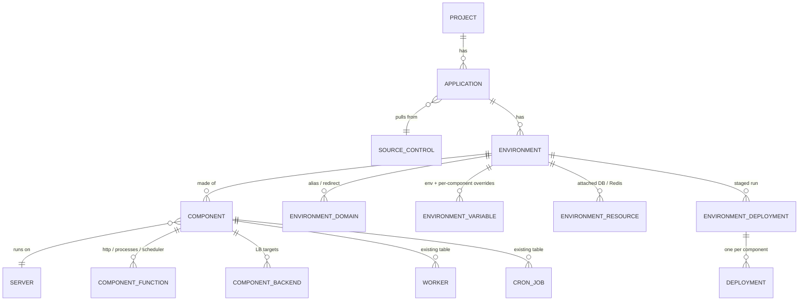
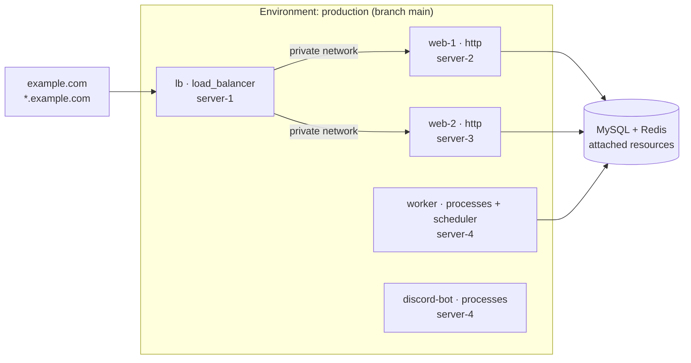

I've built a proof of concept on `feat/apps` that adds **Applications** to Vito. A Site ties one codebase to one server, one domain and one Linux user. That works for a typical Laravel app, but it can't describe a web tier and a queue tier on separate servers, a load-balanced pair of web servers, or a Discord bot that has no HTTP route. Applications separate *what you deploy* from *where it runs* and *how it's reached*.

An **Application** is a repository in a project. It has one or more **Environments** (production, staging, preview…), and each one tracks a branch and holds its own domains, variables, attached databases and Redis, deploy scripts and deployment history. An Environment is made of **Components**. A Component is one placement of the code on one server, and it gets its capabilities from **Functions**: `http` serves the environment's domains, `processes` runs Supervisor workers and `scheduler` runs cron. Plugins can register more Functions. Components can also be `load_balancer`s that forward traffic over a Vito Network to `http` components. `proxy` and `container` types are reserved but not built yet.

<!-- SCREENSHOT 1: Application overview, listing its environments -->

Deploys run per Environment. A push, or a manual click, starts one `EnvironmentDeployment` that fans out to every Component. The deploy moves in **stages**: `clone → build → pre-flight → release`. No Component starts a stage until every Component has finished the previous one. Migrations run once in pre-flight, on the primary component. If anything fails before release, nothing has switched over. If something fails during release, the run is marked `partial` instead of being reported as success.

<!-- SCREENSHOT 2: Environment topology view (domains → components → attached resources) -->

### How it relates to Sites

The two models live side by side, and nobody is forced to migrate. Instead of copying the deploy machinery, the POC reuses the tables and code Sites already use. `deployments`, `deployment_scripts`, `workers`, `cron_jobs` and `git_hooks` each gained a nullable `component_id`/`environment_id` next to `site_id`. Components use the same release-directory layout, vhost templates, SSL issuance, FPM pools, isolated users and GitHub webhooks. Delete checks look at both tables, so removing a Component never deletes an FPM pool or Linux user that a Site still needs.

That overlap gives us the path to replacing Sites. A Site is just an Application with one Environment and one `app` Component with the `http` function, plus `processes` and `scheduler` if it has workers or cron. Once Applications reach feature parity (site types, deployment modes, logs, stats, backups), we can convert each Site to that shape in place. Its rows already fit the shared tables, so the change is mostly re-parenting records. The Sites UI can then be retired.

### Why this model

- **Workloads without a website:** Discord/Telegram bots, queue consumers, websocket servers, schedulers and long-running daemons are now first-class. You don't need a fake domain to deploy them.
- **Horizontal scaling:** split web, queue and scheduler tiers across servers and put a load balancer over a private network in front. Today that means configuring several unrelated Sites by hand.
- **Environments:** staging and production of the same repo share one definition. Each gets its own branch, domains, variables and databases, with optional auto-deploy.
- **Safe multi-server deploys:** the staged release means every server switches together or none of them do.
- **Flexible domains:** a domain belongs to the environment, not the server. Aliases, redirects and wildcards can point anywhere in the topology.
- **Extensible:** plugins add new Functions, and future Component types (containers, reverse proxies) fit in without changing the model.

Feedback welcome, especially on naming (Application / Environment / Component / Function) and on which Site features you'd need before switching over.
